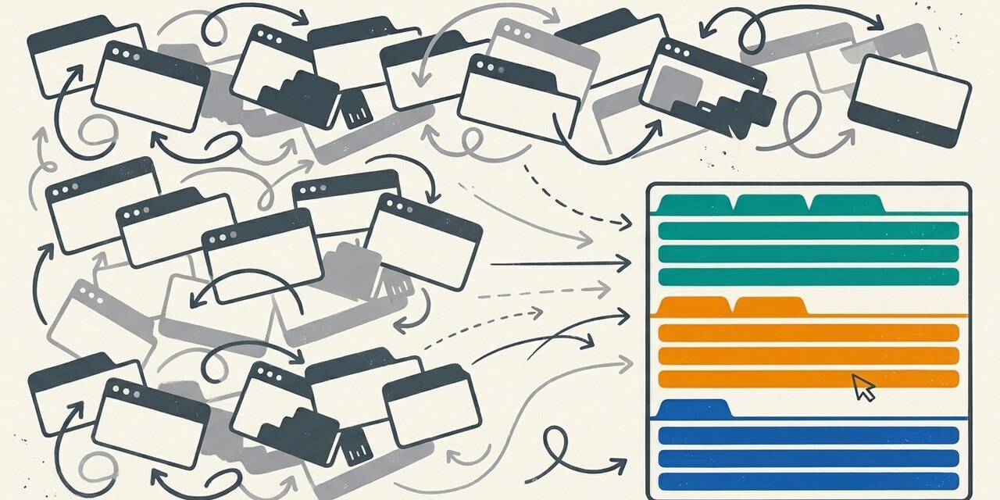
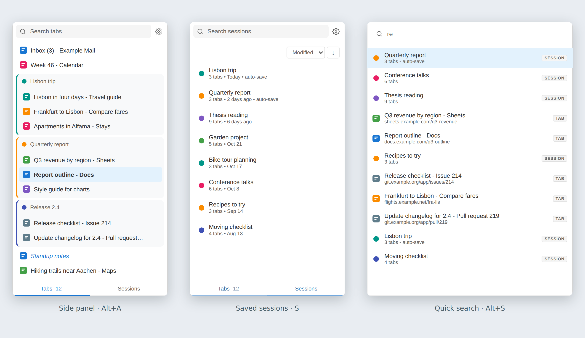

<p align="center">
  
</p>

<table>
<tr>
<td width="100">

</td>
<td>
<h1>Independent Tabs</h1>
A side panel that lists your tabs in an order you choose, independent from the browser tab bar.
</td>
</tr>
</table>

[](https://github.com/frederikberg/independent-tabs/actions/workflows/ci.yaml)
[](https://github.com/frederikberg/independent-tabs/releases)
[](https://opensource.org/licenses/MIT)

Tabs show up in the panel in the order they were opened, and stay where you drag them. Group them, name them, save a group as a session and open it again later, or jump to any tab from a quick search with the keyboard.

<p align="center">
  
</p>

## Why

- **A stable second view of your tabs.** Extensions that switch by most recent use reorder the browser's tab strip all the time. This panel ignores every move event, so a tab stays where you put it.
- **Groups and sessions of your own.** Groups live in the extension, not in the browser's tab groups. Save one as a session, and it comes back as a group with its custom names.
- **Keyboard first.** Every view has single-key shortcuts, and a fuzzy quick search reaches any tab or session without the mouse.
- **Works while the panel is closed.** The service worker tracks opened and closed tabs, so the order is complete whenever you open the panel.
- **Your data stays in the browser.** Everything is in the extension's local storage, and a backup is one JSON file.

## How it fits together

```
tab opened  ->  service worker adds it to the list (bottom or top, or into the group of the tab that opened it)
tab closed  ->  service worker removes it
tab moved   ->  ignored
you drag    ->  side panel writes the new order
```

The order is stored separately from the browser's tab indices. Details: [docs/how-it-works.md](docs/how-it-works.md).

## What you need

A Chromium-based browser with the side panel API. It has run in Microsoft Edge, in Chrome and in Playwright's bundled Chromium, which the browser tests use. The oldest supported version is the manifest's `minimum_chrome_version`.

## Install

There is no store listing. Load it unpacked:

- Download the zip of the [latest release](https://github.com/frederikberg/independent-tabs/releases/latest) and extract it to a folder that stays where it is, or clone this repository.
- Open `chrome://extensions` (`edge://extensions` in Edge) and turn on **Developer mode**.
- Click **Load unpacked** and select the folder.
- Click the extension's toolbar button, or press Alt+A, to open the side panel.

To update, replace the folder's contents and click **Reload** on the extension's card.

## Use it

- Alt+A opens the side panel or puts keyboard focus back into it, Alt+Y closes it, Alt+Q opens the same list in a popup window, Alt+S opens the quick search. Change them at `chrome://extensions/shortcuts`.
- Drag tabs to reorder them. Right-click a tab to rename it or create a group, ctrl-click or shift-click to select several.
- Right-click a group header to save it as a session; the **Sessions** button at the bottom lists them.
- The gear next to the search field opens the settings and the backup.

Every shortcut: [docs/shortcuts.md](docs/shortcuts.md). Every feature with pictures: [docs/features.md](docs/features.md).

## Docs

- [Features](docs/features.md): tabs, groups, sessions, quick search, popup window and settings.
- [Shortcuts](docs/shortcuts.md): global shortcuts and the keys in each view.
- [How it works](docs/how-it-works.md): tab tracking, storage and what the order survives.
- [Development](docs/development.md): tests, screenshots, vendored libraries and releases.

## Known limitations

- The side panel's minimum width (about 340 px) and its side (left or right) are browser settings, not something the extension can change.
- The popup window remembers its size, not its position.
- Tab IDs do not survive a browser restart. Restored tabs join the list in opening order, and group membership of tabs from before the restart is not kept; saved sessions are the way to keep a group across restarts.
- Only tabs of normal browser windows are listed, not PWAs, apps or popups.
- In the side panel, the arrow keys move a cursor and Enter opens the tab, because opening a tab moves keyboard focus into its page. The popup window opens each tab as the cursor reaches it.

## Not affiliated

Independent Tabs is not affiliated with, endorsed or sponsored by Google or Microsoft. Chrome and Edge are trademarks of their owners.

## License

[MIT](LICENSE)
