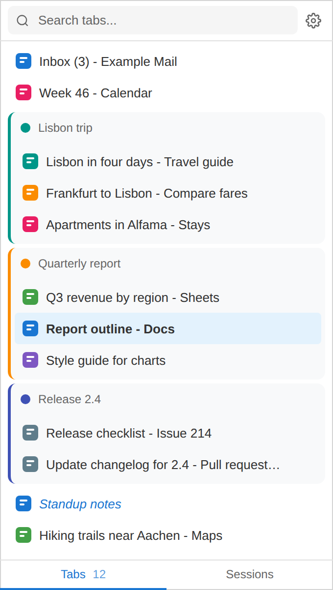
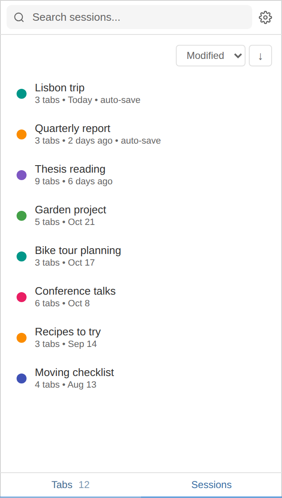
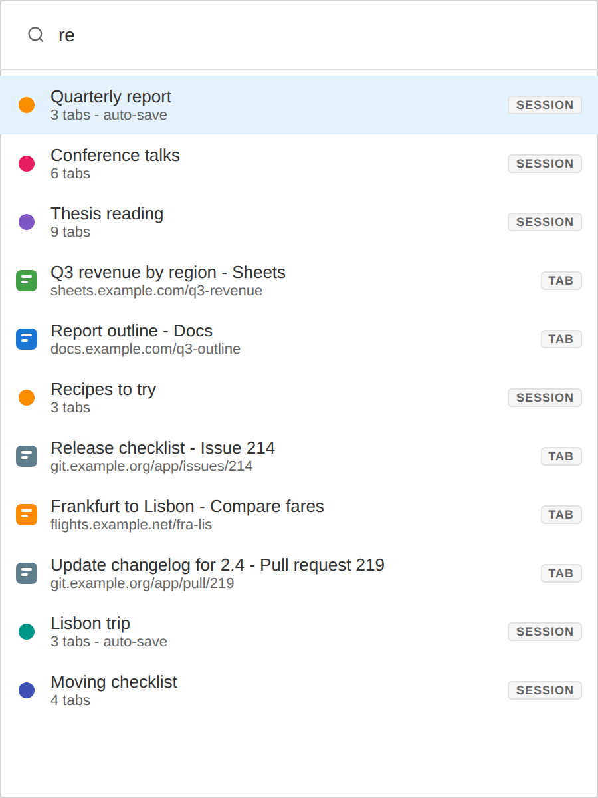
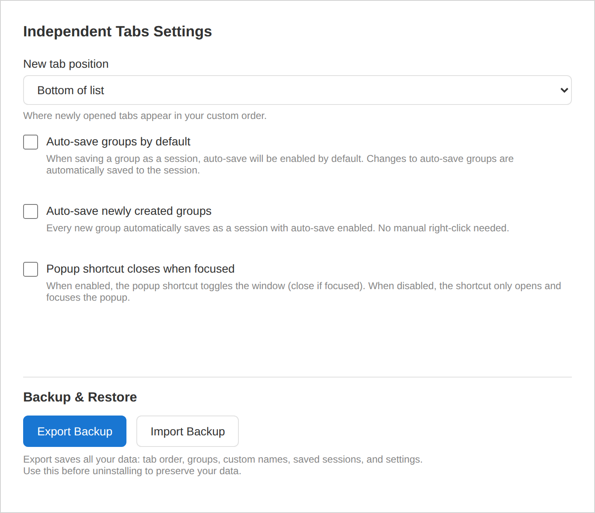

# Features

## Tabs

  

- The list holds the tabs of all normal browser windows, in your order. The active tab is bold.
- Click a tab to activate it without moving window focus; Enter also focuses its window.
- Drag to reorder, including into and out of groups. The × closes a tab.
- Right-click a tab to rename it (a custom name shows in italics), reset the name, create a group, remove it from its group or close it.
- Ctrl-click toggles and Shift-click selects a range; a selection can be dragged, grouped or closed together.
- The search field above the list filters by title, URL and custom name.
- New tabs join at the bottom or the top of the list, set in the settings. A tab opened from a grouped tab joins that group.

## Groups

- Create a group from a tab or a selection; it takes the next unused color of eleven.
- Right-click a group header to save it as a session, rename it, change its color, ungroup it or close all its tabs.
- Groups are stored by the extension and are not the browser's tab groups.

## Sessions

  

- A session is a snapshot of a group: its name, color, and each tab's URL, title and custom name.
- Save from the group's menu; saving again updates the linked session. *Save as new* makes a second one.
- With auto-save on, later changes to the group (tabs added, removed or moved, renames, navigation) update the session. The settings choose whether new sessions start with auto-save and whether every new group is saved at creation.
- Click a session, or press Enter on it, to open it as a group. When its group is already open, the list jumps to that group instead.
- Right-click a session to toggle auto-save, rename it or change its color; the sort control orders by modified, created or name, in either direction. The search covers session names and tab titles.

## Quick search

  

- Without a query it lists every tab in your order. With one it ranks tabs and sessions together by fuzzy match on name, title and URL.
- Enter activates a tab and focuses its window, or opens a session. The window closes when it loses focus.

## Popup window

Alt+Q opens the same list in a popup window. It remembers its size, activates each tab as the cursor reaches it, and closes on Escape.

## Settings

  

- New tab position: top or bottom of the list.
- Auto-save groups by default, auto-save newly created groups, and whether the popup shortcut closes a focused popup.
- **Export Backup** writes tab order, groups, custom names, saved sessions and settings to a JSON file; **Import Backup** replaces all current data with such a file after a confirmation.
